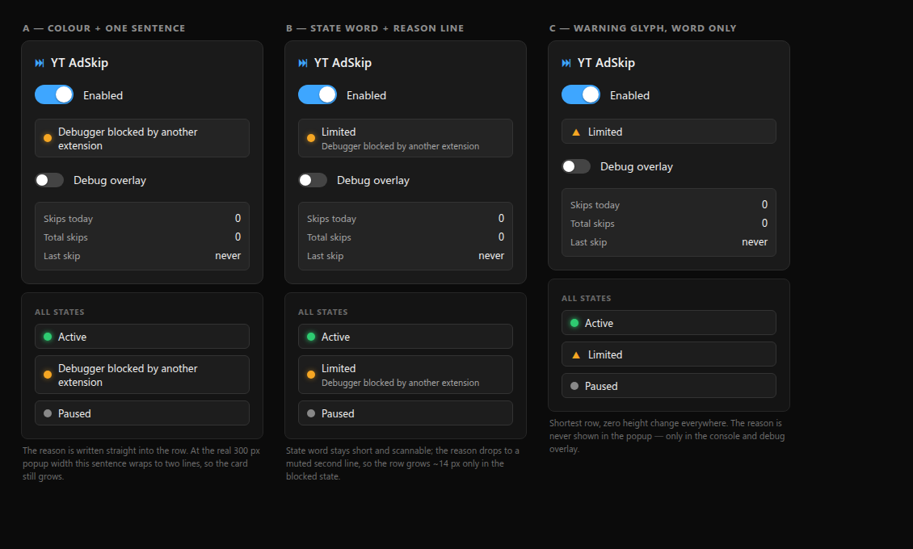

# Design — CDP attaches itself around each ad

- **Status:** revised after design reviews 1–11 · awaiting review 12
- **Date:** 2026-11-07 · **Revision:** 12
- **Topic slug:** `auto-enable-cdp-on-toggle`
- **Requested by:** operator — "Enabling ad skip should automatically enable the browser's CDP."

---

## 0. Revision history

| Rev | Change |
| --- | --- |
| 1 | Initial design; decisions D1 and D2 taken with the operator. |
| 2 | All nine findings of design review 1 resolved (§12). Substantive changes: a per-tab generation guard so a late attach can never leave a session behind; ownership proven by a read-only CDP command instead of trusting `attached`; a startup hydration gate; one idempotent ad-state message replacing two edge messages; honest failure reasons; aggregate publish on every map change including tab removal; retry semantics stated precisely; real markup for the two-line status; version-scoped worker rationale. |
| 3 | Review 2 showed the revision-2 ownership probe is unsound: `sendCommand` can fail for reasons unrelated to ownership (Chromium 40356776), so a spurious failure would leave our own session attached and unmanaged. Replaced with **release, never adopt** (§5.4), which needs no ownership identity and can never mutate a foreign session. The adapter loses `proveOwnership`. |
| 4 | Review 3 found a real race the generation guard alone cannot close: a stale attach resolving after a **newer** attach had already succeeded would detach the live session. Revision 4 serialises every per-tab operation (§5.3.2), adds target enumeration and a detach postcondition to reconciliation (§5.4), replays ad state by heartbeat so a restart mid-ad recovers (§5.9), refreshes the aggregate during hydration (§5.5), and corrects §8. |
| 5 | Review 4 found the remaining gaps were gating and consistency, not architecture: disabled must reject queued work (§5.3.3); reconciliation must be scoped to YouTube tabs (§5.4); the post-detach reason must be ownership-neutral (§5.4); T1.20 and the case count were wrong (§9, §10); hydration is exempt from change-only writes (§5.5, §6). |
| 6 | Review 5 closed the last two correctness gaps: an already-dequeued click could keep dispatching after disable (§5.3.3), `disable` did not clear `adId` so re-enabling mid-ad produced no new edge (§5.3.1, §5.3.3), the §5.8 `listTargets` signature omitted `url` (§5.8), and T3 over-claimed determinism for a real ad (§9). |
| 7 | Review 6 caught three implementability gaps: §5.8 gave the adapter no cancellation signal for the mid-dispatch abort (§5.8), `adId` survived several transitions to `off` and could be reused after a page reload so a new ad was mistaken for a seen one (§5.3.1, §5.9 lifetime token), and detach failures were ignored on grace-expiry and disable paths, which could report `off` while attached (§5.4 postcondition applies everywhere). |
| 8 | Review 7 showed the remaining blockers all traced to one choice: giving ad instances an identity (`adId`, then `lifetime`). Identity created reuse hazards, lifetime-change teardown gaps, and a stale-completion overwrite. **Identity is removed.** The protocol carries a boolean `inAd`; the only thing the machine actually needs is "has an attach already been tried in this continuous ad?", which is a per-tab boolean cleared on every `inAd:false`. §5.3 and §5.9 are rewritten around it, and the adapter no longer pre-filters `listTargets`. |
| 9 | Removing identity left one gap review 8 found: the background could not observe a **full document navigation**, so a destroyed content script looked like the same continuous ad and a spent `attempted` suppressed the new ad's attach. Navigation is now a background-observed event (`chrome.tabs.onUpdated`, §5.3.5), `attaching + external detach` is defined, and the stale-success re-derivation now clears `attempted` when the ad is still live. |
| 10 | Review 9 showed that patching stale completions was treating a symptom: messages and adapter calls were not serialised with each other, so *any* in-flight operation could complete into a state it never saw. **One FIFO per tab now carries both lifecycle events and adapter operations.** With a single serialisation point no completion can interleave with a state change, so the generation counter, the stale-result rules and their invariants are all deleted rather than maintained. |
| 11 | Review 10 found three consequences of the queue: `blocked` could fall to `off` while still attached; a queued disable could never land mid-dispatch, making the abort unreachable; and two tests still specified interleavings the queue forbids. The queue gates *work*, not the `enabled` flag — the flag flips immediately, so `shouldAbort()` works — and every `blocked → off` row now detaches and verifies. |
| 12 | Review 11 showed sampling the `enabled` flag is defeatable: a disable that flips back to enabled between two mouse events makes the next sample read `true` and the dispatch continues. `shouldAbort()` now compares a **monotone `disableEpoch`** captured at dispatch start, so a transient disable is still observed. T1.13's grace-timer step is also made explicit. |

## 1. Background

YT AdSkip clicks YouTube's Skip Ad button with Chrome DevTools Protocol mouse
events, because YouTube's player accepts only `isTrusted: true` clicks and rejects
every DOM-synthesised event. CDP is therefore not an optimisation — it is the only
mechanism this extension has.

Today that CDP session exists only *inside* the click. `background.js` attaches the
debugger, dispatches `mouseMoved` → `mousePressed` → `mouseReleased`, and detaches
again, all within one message round-trip (`cdpClick`). Flipping the popup's
**Enabled** toggle does not touch the debugger at all; it only stops `trySkipAd()`
from being a no-op.

Two consequences follow:

1. The attach handshake sits on the critical path of the one action that must land
   inside a short window, so a slow or refused attach loses the skip.
2. A refused attach is invisible. The popup keeps showing a green **Active** dot
   while skips silently never happen.

## 2. Goals

- **G1** — With the extension enabled, the CDP session opens by itself when an ad
  begins, with no user action, and closes when the ad's pod ends.
- **G2** — The click reuses an already-open session, so no attach handshake is on
  the critical path of the click.
- **G3** — The popup's existing status row distinguishes **working** from merely
  **enabled**, and names the reason when the debugger cannot be obtained.
- **G4** — The session lifecycle is verifiable without a browser and without
  depending on YouTube serving an ad.

## 3. Non-goals

- **N1** — No change to ad detection, to the skip-button selectors, or to the
  `Input.dispatchMouseEvent` sequence and its viewport coordinates.
- **N2** — No change to click-driven retry behaviour, including the deliberately
  unbounded retry recorded in `IGNORED.md` (§5.6 states exactly what is and is not
  bounded).
- **N3** — No unit-test framework for the extension as a whole. Only the new,
  dependency-free state machine gets tests.
- **N4** — No layout change to the popup. The status row keeps its position and
  its neighbours.
- **N5** — Not a fix for 6-second bumper ads, which have no skip button.
- **N6** — No new manifest permission and no raise of `minimum_chrome_version`
  beyond its current `96`.

## 4. Decisions taken with the operator

| ID | Question | Decision | Rejected alternatives |
| --- | --- | --- | --- |
| **D1** | How long should the debugger stay attached while enabled? | **Per ad.** Attach when an ad starts, detach once its pod ends (after a 1.5 s grace period). | Attach for the whole time the toggle is on (blocks DevTools on YouTube permanently); attach for the watch-page lifetime (yellow bar stays for the entire video). |
| **D2** | How should the popup surface a refused attach? | **Variant B** — keep the existing status row; a short state word on line one and a muted reason line beneath it. | A: reason written straight into the row (wraps to two lines at 268 px inner width anyway, so it costs the same height and scans worse); C: amber glyph and word only, hiding the reason. |

**D1 detail.** "Per ad" means the ad's own lifetime, not the click's. Detaching the
instant the click lands would (a) force a re-attach when a click fails, exactly when
the window is tightest, and (b) produce one attach/detach pair per ad inside a pod.
The session is released by the pod ending, not by the click succeeding.

**D2 detail.** Green **Active** keeps its current meaning: enabled and able to act.
It does *not* mean "currently attached" — under D1 the debugger is legitimately
detached between ads, so an "attached" green state would flicker.

### Recorded mockup



Repo path: `docs/superpowers/specs/assets/2026-11-07-popup-status-states.png`.
Rendered at the popup's real dimensions: 300 px card, 16 px padding, 268 px inner
width, `box-sizing: border-box` as in `extension/popup/popup.css`.

## 5. Architecture

### 5.1 Components

| Component | New? | Responsibility |
| --- | --- | --- |
| `extension/cdp-session.js` | new | The session state machine. Pure decision logic; performs no `chrome.*` call and touches no DOM. Driven by an injected adapter and injectable timers; no clock, no randomness. |
| `extension/status.js` | new | Pure view-model: `{enabled, cdp}` → `{state, word, reason}` for the single status row. |
| `extension/background.js` | rewritten | ES module. Hydrates `enabled` before serving messages, wires `cdp-session.js` to `chrome.debugger`, `chrome.tabs` (including `onUpdated` document boundaries, §5.3.5), and `chrome.storage`, and owns the `cdp` key. |
| `extension/content.js` | edited | Reports one idempotent ad-state edge stream and sends clicks. Makes no session decision. |
| `extension/popup/*` | edited | Three-state status row per D2, with real markup (§7). |
| `extension/manifest.json` | edited | `"background": { "service_worker": "background.js", "type": "module" }`. |

### 5.2 Why the truth comes from the browser

`chrome.debugger.getTargets()` reports `attached` per target. An in-memory `Map` in
the service worker is the obvious implementation and is not sufficient on its own:
the worker can be restarted at any time by an update, a crash, or explicit
termination, and on Chrome versions older than 118 also by ordinary idle timeout.
(Chrome 118+ keeps the worker alive while a `chrome.debugger` session is active, so
idle death is not the only case — the rule below does not depend on that
optimisation and must not assume it.)

**Rule:** attachment state is read from `chrome.debugger.getTargets()` at every
decision point, and a session the current worker did not attach is **released, never
adopted** (§5.4). Any in-memory cache is an optimisation and is never authoritative.

### 5.3 Session state machine

Each tab has a record `{ state, inAd, attempted, reason, timer, expectDetach, queue }`.

- `inAd` is the latest lifecycle value the content script reported.
- `attempted` answers one question: *has an attach already been tried during this
  continuous ad?* Set when an attach starts, cleared whenever `inAd` becomes false, on a
  document boundary, and on disable.
- `expectDetach` keeps an intentional detach from being reported as an external one.
- `disableEpoch` is a session-global monotone counter, incremented on every transition to
  disabled; it is what makes a transient disable observable mid-dispatch (§5.3.3).

**One queue, one truth (revision 10).** Every input for a tab — `adState`, `click`,
disable, document boundary, external detach, and the completion of an adapter call —
runs through the same per-tab FIFO and executes to completion before the next begins.
Two consequences make the rest of this section small:

1. No adapter operation can interleave with a state change. An `{inAd:true}` that
   arrives while a detach is running is *processed after* it, so it sees `off` and
   attaches; it never observes a half-applied state.
2. **No generation counter is needed.** Revisions 4–9 used one to detect stale async
   results, and every subsequent review found another path where a stale result could
   corrupt newer state. With a single queue nothing is ever stale: at the moment a
   completion is handled, no event has been handled since it started. The counter, its
   staleness rules, and their invariants are deleted.

`state` is therefore a pure function of the ordered inputs already processed, and §5.3.1
is an ordinary sequential state machine.

Public states. `attaching` and `draining` are internal; the published value is always
exactly one of `off`, `attached`, `blocked` (an `attaching` tab publishes `off`; a
`draining` tab publishes `attached`).

#### 5.3.1 Transition table (total)

Every `inAd:true` row must be idempotent, because the content script re-sends it every
2 s; the row that attaches is guarded by `attempted`, not by any ad identifier.

| State | Event | Next | Effect |
| --- | --- | --- | --- |
| `off` | `inAd:true`, `attempted=false` | `attaching` | `attempted=true`; `adapter.attach` |
| `off` | `inAd:true`, `attempted=true` | `off` | none — this ad's single attempt is spent |
| `off` | `inAd:false` | `off` | `attempted=false` |
| `off` | disable | `off` | none |
| `off` | click | `attaching` | `attempted=true`; attach, then dispatch (§5.6) |
| `off` | external detach | `off` | none |
| `off` | document boundary | `off` | `attempted=false` |
| `attaching` | attach ok | `attached` | `expectDetach=false`; publish |
| `attaching` | attach refused | `blocked` | publish `{state:"blocked", reason}`; `attempted` stays true |
| `attaching` | `inAd:true` | `attaching` | none — the in-flight guard |
| `attaching` | `inAd:false` | `off` | `attempted=false` |
| `attaching` | disable | `off` | `attempted=false`; detach + verify (§5.4) |
| `attaching` | click | `attaching` | enqueue the dispatch behind the attach; never a second attach |
| `attaching` | external detach | `blocked` | publish "Detached by the browser" |
| `attaching` | document boundary | `off` | `attempted=false`; detach + verify |
| `attached` | `inAd:true` | `attached` | none |
| `attached` | `inAd:false` | `draining` | `attempted=false`; start grace timer |
| `attached` | disable | `off` | `attempted=false`; clear timer; `expectDetach=true`; abort in-flight dispatch; detach + verify |
| `attached` | external detach | `blocked` | publish "Detached by the browser" |
| `attached` | click | `attached` | dispatch; never attach, never detach |
| `attached` | document boundary | `off` | `attempted=false`; `expectDetach=true`; detach + verify |
| `draining` | `inAd:true` | `attached` | cancel timer; `attempted=true` |
| `draining` | `inAd:false` | `draining` | none (the timer is not restarted) |
| `draining` | grace elapsed | `off` | `expectDetach=true`; detach + verify |
| `draining` | disable | `off` | clear timer; `attempted=false`; `expectDetach=true`; detach + verify |
| `draining` | click | `draining` | dispatch; keep the timer |
| `draining` | external detach | `blocked` | cancel timer; publish |
| `draining` | document boundary | `off` | clear timer; `attempted=false`; detach + verify |
| `blocked` | `inAd:true` | `blocked` | none — this ad's attempt is spent |
| `blocked` | `inAd:false` | `off` | `attempted=false`; **detach + verify (§5.4)** — a blocked tab may still hold a session; clear reason; publish |
| `blocked` | disable | `off` | `attempted=false`; `expectDetach=true`; **detach + verify (§5.4)**; clear reason; publish |
| `blocked` | click | `attaching` | `attempted=true`; attach, then dispatch (§5.6) |
| `blocked` | external detach | `blocked` | none |
| `blocked` | document boundary | `off` | `attempted=false`; **detach + verify (§5.4)**; clear reason; publish |
| any | tab removed | — | drop queued work, forget the record, **never detach**, republish aggregate |

`expectDetach` exists so an intentional detach is not misreported: an `onDetach` whose
tab has `expectDetach === true` yields `off`; any other `onDetach` yields `blocked`.

#### 5.3.2 Why serialisation replaced the generation guard

Reviews 1, 3, 7 and 9 each found a different way for an asynchronous completion to land
in a state it never saw: a late attach releasing a newer session, a stale success
stranding a queued attempt, a grace-expiry detach completing after a new ad had started
and suppressing it, a stale success leaving `off` with `attempted=true`. Each revision
patched the instance; the next review found the next one.

The queue removes the class. Because a completion is handled only when it reaches the
head, and no event is handled between its start and its completion, there is nothing for
it to be stale *relative to*. `attempted` is therefore always consistent with the
completion that set it:

| Sequence that used to leak | With one queue |
| --- | --- |
| attach pending, ad ends, new ad starts, attach succeeds | the ad end and new start are queued behind the attach; attach completes into `attached`, then `inAd:false` → draining, then `inAd:true` → attached |
| grace expiry detaches, `inAd:true` arrives mid-detach | the detach completes (`off`), then `inAd:true` is processed from `off` and attaches |
| disable while attaching | attach completes, then disable detaches and verifies |
| click during attach | dispatch runs after the attach settles |

Ordering across tabs is irrelevant; the queue is per tab.

#### 5.3.3 Disabled gates every entry point

`enabled` is **not** queue-gated. The storage listener writes the `enabled` flag
immediately, and only the resulting *teardown work* is enqueued. Review 10 showed why this
distinction matters: if the flag were updated by queued work, a disable could never land
while `dispatchClick` held the queue slot, so `shouldAbort()` could never observe it and
the mid-dispatch abort would be unreachable.

Every other entry point is checked when its work reaches the head of the queue:

| Entry point | While disabled |
| --- | --- |
| `adState({inAd:true})` (edge or heartbeat) | ignored; no attach |
| `adState({inAd:false})` | still processed — a teardown replay is harmless and keeps records honest |
| `click()` already queued | dropped before dispatch; returns `{ok:false, message:"disabled"}` |
| `click()` arriving while disabled | dropped immediately; no attach |
| `adskip:hello` broadcast, heartbeat send | not emitted by content, ignored by background |

Queued work also drops when its tab is removed. **Disable clears `attempted`**, so
re-enabling mid-ad attaches on the next `{inAd:true}` instead of deadlocking.

**An in-flight dispatch aborts, via a latch rather than a flag sample.** `dispatchClick`
sends `mouseMoved`, `mousePressed`, `mouseReleased` with two short pauses, calling the
`shouldAbort` callback between events.

Review 11 found that sampling `enabled` alone is defeatable: a disable that flips back to
enabled between two samples makes the *next* sample read `true`, and the dispatch continues
as though nothing happened. The session therefore keeps a session-global monotone
`disableEpoch`, incremented on **every** transition to disabled — including one immediately
undone — and the dispatch captures it at start:

```js
shouldAbort = () => !enabled || disableEpoch !== epochAtDispatchStart;
```

A transient disable can no longer be erased by a re-enable, because the counter never
decrements. A click stopped this way returns `{ok:false, message:"disabled"}`; a partially
delivered sequence is accepted as the cost of honouring the switch, and `expectDetach` is
set so the resulting `onDetach` is not misreported.

#### 5.3.5 A full document navigation is a background-observed boundary

Review 8 found the gap that removing identity opened. An SPA transition fires
`yt-navigate-finish` and the content script keeps reporting, but a **full document
navigation** destroys the content script. Two failures follow:

1. The old script never sends `inAd:false`. The fresh script's first `{inAd:true}` would
   look like the same continuous ad, so a spent `attempted` (typically after a refusal)
   suppresses the new ad's attach.
2. Navigating to a non-YouTube page leaves *no* content script at all, so nothing ever
   reports `inAd:false` and the per-ad session is never torn down.

**The background observes navigations itself.** `chrome.tabs.onUpdated` fires with
`changeInfo.status === 'loading'` for a top-level new document — subresource and
same-document activity do not set it — and reading only `status` needs no extra
permission (the `url` field would; N6 still holds). It calls
`session.documentBoundary(tabId)`, which **enqueues** this teardown on that tab's queue:

| Step | Effect |
| --- | --- |
| 1 | drop queued work for the tab (a pending click or heartbeat is for the dead document) |
| 2 | `attempted = false` |
| 3 | if attached, draining, attaching, **or blocked**: `expectDetach = true`, detach and verify (§5.4) — a `blocked` tab may be blocked precisely because a session survived |
| 4 | `off`; the fresh content script's next report drives the state normally |

If the tab is already gone, or `listPageTarget()` reports no page target, **step 3 is
skipped**: there is nothing to detach and a removed tab is never detached (§5.4). The
queue then re-derives `off`. Rapid successive boundaries are harmless — each is a
teardown of a document that no longer exists — and a boundary that lands while a detach is
already in flight is processed after it, so nothing interleaves.

### 5.4 A session this worker did not create is released, never adopted

`attached: true` means *some* debugger client holds the target — DevTools, another
extension, or this one. Chrome exposes no owner identity, so the flag cannot distinguish
those cases, and review 1 was right that adopting on it is a guess.

Revision 2 tried to settle it with a read-only `sendCommand` probe. **Review 2 showed
that is unsound:** `sendCommand` fails for reasons unrelated to ownership — notably
immediately after a navigation, while Chromium rebinds the DevTools agent host (issue
40356776). A spurious failure would classify our own live session as foreign.

**Rule: release, never adopt.** Reconciliation runs once per worker start, before
`readyPromise` resolves, and for a tab with no record:

1. `adapter.listTargets()` enumerates every **page** target with
   `{tabId, attached, url}`, then filters to YouTube tabs (`https://www.youtube.com/*`).
   Review 3: the previous contract had no way to enumerate, so it could not run at all.
   Review 4: without the filter, an unrelated attached tab would be recorded as
   `blocked` and pollute the global aggregate, so non-YouTube targets are ignored
   entirely — never tracked, never detached, never published.
2. For a tab whose target shows `attached === false` → `off`.
3. For a tab whose target shows `attached === true` → enqueue exactly one
   `adapter.detach(tabId)`, then **verify the postcondition** by re-reading
   `listTargets()` for that tab:

   | Post-detach observation | Recorded state |
   | --- | --- |
   | `attached === false` | `off` — the session was released (ours or not) |
   | `attached === true` | `blocked`, reason `Debugger remains attached — owner unknown` |
   | no page target any more | forget the tab |

**The postcondition applies to every detach, not only reconciliation** (review 6). Grace
expiry and disable also detach; if either published `off` without checking, a failed detach
would leave the debugger attached while the extension claimed D1's per-ad window was
closed, and the *next* attach would fail for a reason the popup never explained. So
§5.3.1's `off` is only published after a confirmed release:

| Detach outcome (re-read `listTargets()`) | Published state |
| --- | --- |
| `attached === false` | `off` |
| `attached === true` still | `blocked`, reason `Debugger remains attached — owner unknown` |
| no page target any more | `off` (tab gone) |

**A rejected or unverified `detach` is never treated as evidence about ownership.** That
was review 3's correction. Review 4 sharpened it: an `attached === true` observation after
a failed detach proves only that *a debugger remains attached* — it could still be this
extension's own old session. The reason text is therefore ownership-neutral ("owner
unknown") and the design never claims to have identified another client.
It reports only what Chrome exposes reliably (`attached`), and T1.19 pins that it never
claims more.

Consequences, stated plainly:

- This extension never sends a CDP command to a session it did not attach in this
  worker's lifetime. No probe, no `proveOwnership`, no adoption.
- A session held by DevTools or another extension is left untouched. The postcondition
  will read `attached === true`, the tab records `blocked`, and the popup says so
  honestly instead of guessing who owns it.
- A worker restart during an ad costs one detach and one re-attach. §5.9's heartbeat is
  what guarantees the re-attach actually happens; without it, content would be sitting
  in `inAd` with no new edge to report (review 3, finding N3).

### 5.5 Startup hydration gate

`enabled` must be known before the first message is served, or the first ad after a
worker wake is judged against a stale value (review 1 finding 3, and the documented
start-up race in `AGENTS.md` §4.7, where the content script begins polling before
its own asynchronous storage read).

`background.js` keeps a single `readyPromise` created at module scope:

```js
const readyPromise = (async () => {
  const { enabled } = await chrome.storage.local.get({ enabled: true });
  session.setEnabled(enabled !== false, { silent: true });
  await session.reconcile();
  await session.publishAggregate();      // §5.5: never inherit a stale `cdp` value
})();
```

Every message handler and the `chrome.storage.onChanged` listener `await
readyPromise` before touching the session. The default for an absent key is `true`,
matching both the content script and the popup.

**Hydration must also refresh the aggregate** (review 3, finding N4). `cdp` persists
across worker restarts, so a `blocked` value written before the restart would otherwise
survive with no map change to trigger a republish — the popup would show **Limited** for
a session that no longer exists. `readyPromise` therefore ends with an unconditional
`publish(aggregate())` after reconciliation, and resolves only once that write has been
issued. **This write is exempt from the change-only rule in §6** (review 4): suppressing
it because the recomputed value *looks* equal would preserve exactly the stale value it
exists to clear.

### 5.6 Click path and retry semantics

Precise statement, resolving review 1 finding 7:

| Trigger | Attach attempts | Bounded? |
| --- | --- | --- |
| Ad start (autonomous) | exactly one per continuous ad (`attempted` boolean) | **yes** — no autonomous re-attach until `inAd` goes false or the extension is disabled |
| Click finding no session | one attach, then dispatch | **no** — unchanged from today |
| Click failure | content resets `cdpAttempted` and the poll retries | **no** — unchanged from today (`IGNORED.md`) |

So N2 is honest: click-driven retry behaviour is untouched. "One attempt per ad"
governs only the automatic attach, which did not exist before this feature.

`session.click(tabId, x, y)`: if `attached`, dispatch immediately. Otherwise **enqueue**
the click behind any in-flight operation (§5.3.2), attach once if still needed, then
dispatch. A queued click is re-checked against `enabled` at dequeue and dropped if the
weak extension has been disabled (§5.3.3). On any failure it returns
`{ok:false, message}` and leaves state `blocked`. **A click never detaches, and never
starts a second attach while one is in flight.** **A click never runs while disabled.**

### 5.7 Several YouTube tabs at once

The session map is per tab, but `cdp` is one key in `chrome.storage.local`. With two
watch tabs, one attached and one refused, "last transition wins" would make the dot
flicker and sometimes lie.

**Rule:** `publish()` writes the **aggregate** `{state, reason, at}` over every
tracked tab, recomputed after **every** map change — attach, detach, refusal,
`onDetach`, disable, and **tab removal**. Priority: any tab `blocked` ⇒ `blocked`
with the most recent blocking reason; else any `attached` ⇒ `attached`; else `off`.
Tab removal drops the record and republishes, so removing the last blocked tab
returns the popup to **Active** instead of stranding **Limited** on screen
(review 1 finding 6). Removing a tab never calls `detach`.

### 5.8 `cdp-session.js` contract

```js
export const DETACH_GRACE_MS = 1500;

/**
 * adapter: {
 *   listTargets(): Promise<Array<{tabId:number, attached:boolean, url:string}>>,  // page targets,
 *                                              // ALL page targets; the machine filters to YouTube (§5.4)
 *   listPageTarget(tabId): Promise<{attached:boolean} | null>,
 *   attach(tabId): Promise<{ok:true} | {ok:false, code:string, message:string}>,
 *   detach(tabId): Promise<{released:boolean}>,  // resolves released:false on failure; caller verifies
 *                                              // with listPageTarget() per §5.4
 *   // the session supplies shouldAbort() — !enabled || disableEpoch changed (§5.3.3);
 *   // the adapter MUST re-check it between the three injected events and send no further
 *   // event once it returns true
 *   dispatchClick(tabId, x, y, shouldAbort: () => boolean):
 *       Promise<{ok:true} | {ok:false, message:string}>,
 * }
 * timers: { set(fn, ms): id, clear(id): void }
 * publish(cdp: {state, reason, at}): void      // receives the AGGREGATE (§5.7)
 */
export function createCdpSession({ adapter, timers, publish, now, graceMs = DETACH_GRACE_MS });

// returned object
{
  setEnabled(bool, { silent = false } = {}): Promise<void>,
  reconcile(): Promise<void>,                       // §5.4 release-never-adopt, uses listTargets()
  documentBoundary(tabId): Promise<void>,           // §5.3.5 enqueued teardown for a new document
  publishAggregate(): Promise<void>,                // §5.5/§5.7 recompute + persist
  adState(tabId, { inAd }): Promise<void>,          // idempotent; heartbeat-safe
  click(tabId, x, y): Promise<{ok:boolean, message?:string}>,
  handleDetach(tabId): Promise<void>,               // consults expectDetach
  handleTabRemoved(tabId): Promise<void>,
  status(tabId): {state: "off"|"attached"|"blocked", reason: string|null},
}
```

Attach error codes normalised by the adapter: `UNAVAILABLE` (any refusal whose cause
Chrome does not reliably identify — the normal case), `NO_TARGET`, `OTHER`.
No `EXTENSION_CONFLICT` / `DEVTOOLS_OPEN` codes: §8 explains why Chrome cannot
support them honestly.

### 5.9 Message protocol

One idempotent lifecycle message replaces separate start and end messages
(review 1 finding 4). Content script → background:

| Message | Payload | Background action |
| --- | --- | --- |
| `adskip:adState` | `{inAd: boolean}` | `session.adState(tabId, payload)` |
| `adskip:click` | `{x, y}` | `session.click(tabId, x, y)` |

The payload carries **no ad identifier** (revision 8). Duplicates are no-ops for every
row of §5.3.1, so a repeated `{inAd:false}` cannot restart the grace timer and a repeated
`{inAd:true}` cannot re-attach — the `attempted` boolean, not an id, is what makes the
second `{inAd:true}` a no-op. A content script destroyed by a full page navigation needs
no special handling either: the fresh script's first `{inAd:true}` meets a record whose
`attempted` is either already true for the same continuous ad (no-op, correct) or false
(attaches, correct). There is nothing to collide with, because there is nothing to
identify.

**Heartbeat (review 3, finding N3).** An edge-only stream cannot recover a worker
restart, because content is already `inAd` and has no new edge to send — the session
would be detached by reconciliation and never re-established. The content script
therefore also re-sends the same `{inAd}` payload **every 2 s while `inAd` is
true and the extension is enabled**, and once on receipt of an `adskip:hello` message
that the background broadcasts to YouTube tabs after `readyPromise` resolves. Both are
suppressed while disabled (§5.3.3). Repeated identical payloads stay no-ops
for the state machine, but they are the liveness signal that makes the re-attach
happen.

**Single lifecycle source.** The content script keeps its existing 250 ms poll as
the sole authority for `inAd = isAdPlaying()`. `onAdStart`, `onAdFinish`, and
`yt-navigate-finish` no longer emit lifecycle edges of their own; they force an
immediate re-read of `isAdPlaying()` on the next tick. This removes the three-way
duplication review 1 found, keeps the existing player hooks useful as latency
reducers, and makes `yt-navigate-finish` send one `{inAd:false}` if the script
believed it was in an ad.

There is deliberately **no** `adskip:disabled` message: `chrome.storage.onChanged`
for `enabled` is the single owner of the disable path. The background also registers
`adskip:hello` as an outbound message only; content never initiates it.

## 6. Storage schema delta

One new key in `chrome.storage.local`, written by the background only, on aggregate
change only — **except** the mandatory hydration write in §5.5, which always happens:

```jsonc
"cdp": { "state": "off" | "attached" | "blocked", "reason": "string | null", "at": 1762500000000 }
```

Existing keys (`enabled`, `stats`, `today`, `debugOverlay`) are untouched. `AGENTS.md`
§5 and the `README.md` privacy list must both learn this key, because the privacy
list enumerates exactly which keys the extension writes.

## 7. Popup rendering (D2)

`status.js`:

```js
export function deriveStatus({ enabled, cdp }) -> {
  state: "active"|"limited"|"paused", word: "Active"|"Limited"|"Paused", reason: string|null
}
```

| `enabled` | `cdp.state` | Result |
| --- | --- | --- |
| `false` | any | `paused` / "Paused" / null |
| `true` | `"blocked"` | `limited` / "Limited" / `cdp.reason` |
| `true` | `"off"` or `"attached"` | `active` / "Active" / null |

**Markup** (review 1 finding 8 — the two-line treatment needs real structure; the
row is currently a flex row with a single `.status-text`):

```html
<section class="status" id="status">
  <span class="dot" id="status-dot" aria-hidden="true"></span>
  <span class="status-text" id="status-text">
    <span class="status-word" id="status-word">Active</span>
    <span class="sub" id="status-reason" hidden></span>
  </span>
</section>
```

**CSS additions** to `extension/popup/popup.css`:

```css
:root { --warn: #f5a623; }                       /* and in the light theme block */
.status-text { display: flex; flex-direction: column; gap: 2px; min-width: 0; }
.status-word { font-size: 13px; }
.status-text .sub { font-size: 11px; line-height: 1.35; color: var(--fg-muted); }
.status.limited .dot { background: var(--warn); box-shadow: 0 0 6px rgba(245, 166, 35, 0.55); }
```

Existing `.status.active` / `.status.paused` rules and the `--good` colour are
unchanged. `popup.html`'s script tag becomes `<script type="module" src="popup.js">`
so it can import `deriveStatus`.

## 8. Error handling

Chrome does not reliably identify *why* an attach was refused. The review cited
Chromium issue 40753571: attach can fail with the "different extension" wording when
a page merely contains a restricted extension iframe, and `management.getAll()`
lists *enabled* extensions, not the current debugger owner.

So the popup tells the truth and does not guess:

| Failure | State | Reason text shown |
| --- | --- | --- |
| Attach refused, cause not identifiable | `blocked` | `Debugger unavailable — close DevTools or disable other extensions, then try again` |
| No page target yet | `blocked` | `Debugger unavailable — page still loading` |
| `onDetach` with `expectDetach === false` | `blocked` | `Detached by the browser` |
| `onDetach` with `expectDetach === true` | `off` | none |
| Tab closed | forget tab; republish aggregate | — |
| Disabled | detach every tracked tab; republish | — |
| Worker restart | §5.4 release-never-adopt, then §5.9 heartbeat re-attaches if an ad is live | — |

Extension names may appear in the **debug overlay and console** as troubleshooting
suggestions, prefixed `possibly:`. They are never presented as the identified owner
and never reach the status row.

One consequence stated plainly: an attach refusal still blocks skips for that ad,
because the click needs a live session. What changes is that the popup now says so
instead of showing a green dot over a broken pipeline.

## 9. Test strategy

**T1 — `tests/unit_cdp_session.mjs`, `node --test`, no dependencies.** Fake adapter,
fake timers, captured `publish` calls:

1. one ad start attaches exactly once;
2. a repeated `{inAd:true}` — heartbeat or duplicate edge — performs no adapter call;
3. a click on an attached session dispatches and never attaches or detaches;
4. a click with no session attaches once, then dispatches;
5. pod rollover inside the grace window yields one attach and one detach overall;
6. grace expiry without rollover detaches exactly once;
7. a refusal publishes `blocked` and makes no second autonomous attempt in the same ad;
8. `onDetach` while attached flips to `blocked`;
9. disable during an attached ad detaches immediately and clears the timer;
10. `handleTabRemoved` drops the tab, never detaches, and republishes;
11. two tabs, one blocked and one attached, publish `blocked`, returning to
    `attached` once the blocked tab's ad ends;
12. an attach that succeeds just as the operator disables is followed by the queued
    disable, which detaches and verifies: the tab ends `off` with no session left;
13. the same sequence when the ad ends instead of a disable: the queued `inAd:false`
    enters `draining`, and advancing the fake grace timer then detaches and verifies,
    ending `off` with no session left;
14. **late attach success after tab removal** detaches nothing for the dead tab and
    leaves the record gone;
15. `blocked` + ad end ⇒ `off` and reason cleared;
16. `{inAd:false}` arriving during an attach is processed **after** it: attach →
    `attached`, then ad end → `draining`. No session is released while the ad is still
    playing, and exactly one attach occurred;
17. intentional `detach()` (via grace expiry) with a following `onDetach` yields
    `off`, not `blocked`;
18. `reconcile()` with a pre-existing attachment calls `detach` exactly once and
    starts at `off`, and never issues a probe command;
19. `reconcile()` whose `detach` leaves the target still attached records `blocked` with
    an ownership-neutral reason, never `off`, and never asserts who owns the session;
20. **an ad end and a new ad start arriving during an attach are processed after it**:
    the attach completes into `attached`, then `inAd:false` → `draining`, then
    `inAd:true` → `attached`, with exactly one adapter attach in total;
21. a click arriving during `attaching` joins the queue and produces exactly one
    attach and one dispatch;
22. a heartbeat re-send while already `attached` performs no adapter call, and a
    heartbeat after a simulated restart re-establishes the session;
23. hydration publishes the aggregate unconditionally, so a stale `blocked` value
    cannot survive a restart (exempt from the change-only rule);
24. disable drops a queued click before dispatch and returns `{ok:false,"disabled"}`;
25. an `{inAd:true}` heartbeat or `hello` while disabled performs no attach, while an
    `{inAd:false}` replay is still accepted;
26. `reconcile()` ignores non-YouTube page targets: they are never tracked, never
    detached, and never affect the published aggregate;
27. disable mid-ad then re-enable mid-ad: `attempted` was cleared, so the next
    `{inAd:true}` attaches again;
28. a dispatch in flight when disable lands sends no further mouse event: the flag flips
    immediately (it is not queue-gated), so the fake adapter observes `shouldAbort()`
    returning true between events; the click returns `{ok:false,"disabled"}`, and the
    queued disable then detaches and verifies;
29. a `detach` that reports `released:false` and leaves the target attached on every
    detach path — grace expiry, disable, reconciliation — publishes `blocked`, never `off`;
30. **an `{inAd:true}` arriving while a grace-expiry detach is in flight** is processed
    after the detach: the tab passes through `off` and then attaches, so the new ad is
    never suppressed and `attempted` is true only with a live session;
31. every state-changing transition whose next state is `off` leaves `attempted === false`
    (the `off` + `inAd:true` + `attempted` row is a pure no-op and is excluded);
32. a document boundary (`onUpdated` with `status:'loading'`) drops queued work, clears
    `attempted`, detaches and verifies, so a fresh content script reporting `{inAd:true}`
    attaches even though the previous ad was refused;
33. `attaching` followed by an external detach records `blocked` and no session is
    adopted;
34. a document boundary for a tab that is already gone, or whose `listPageTarget()`
    returns null, performs **no detach** and ends at `off`;
35. every `blocked → off` path (`inAd:false`, disable, document boundary) detaches and
    verifies, and publishes `off` only when the release is confirmed;
36. a disable that is undone by a re-enable **between two mouse events** still aborts the
    dispatch: `shouldAbort()` reports true because `disableEpoch` moved, and no third
    event is sent;

**T2 — `tests/unit_status.mjs`.** Pins the §7 table for every pair, and that a
blocked state carries the reason verbatim.

**T3 — `tests/test_adskip.py` (Playwright E2E), extended.** Two distinct halves, because
conflating them is what review 5 caught:

- **Deterministic, asserted every run:** the extension loads under the ES-module
  background; the worker starts; hydration publishes `cdp`; the popup renders all three
  status states; the content script handshake (`adskip:hello` reply) arrives.
- **Best-effort, explicitly skippable:** if YouTube actually serves an ad, assert the
  console sequence `attach → click → detach`. If no ad appears in the allotted videos,
  report `SKIP: no ad served` and pass — never fail, and never claim coverage it did not
  obtain. The deterministic proof of the sequence lives in T1, which drives the state
  machine directly; T3 is opportunistic confirmation against real Chrome only.

**T4 — `node --check`** on every touched JavaScript file, before T1–T3.

**T5 — mockup harness.** The popup rendered in all three states at 300 px, re-rendered
after the §7 CSS change to confirm the two-line row matches the recorded asset.

Honest limit: T1/T2 prove the state machine and label mapping. They cannot prove that
Chrome attaches as expected, and T3 cannot be made deterministic because YouTube's ad
serving in automated Chrome is unreliable — a documented limitation in `TESTING.md`.

## 10. Files changed

```
extension/cdp-session.js      new   session state machine, adapter-driven, one FIFO per tab
extension/status.js           new   pure status view-model
extension/background.js       rewrite  hydration gate, reconciliation, adapter, router, cdp key
extension/content.js          edit  single adState edge stream; no session decisions
extension/manifest.json       edit  background.type = "module"
extension/popup/popup.js      edit  render three states via status.js (module)
extension/popup/popup.html    edit  nested status markup; script type="module"
extension/popup/popup.css     edit  --warn, .status-text column, .sub, .status.limited
tests/unit_cdp_session.mjs    new   T1 (36 cases)
tests/unit_status.mjs         new   T2
tests/test_adskip.py          edit  T3 sequence and hydration assertions
AGENTS.md                     edit  §4 lifecycle, §5 cdp key, §8 edge cases
README.md                     edit  behaviour and privacy key list
TESTING.md                    edit  new test commands
docs/superpowers/specs/...    this document + assets
```

## 11. Risks

- **R1 — ES-module background.** Supported from Chrome 91 against a 96 floor; T3
  proves the worker starts.
- **R2 — infobar flicker.** D1 trades a permanent bar for a per-ad bar. Accepted by
  the operator; the reason D1 was chosen over the alternatives.
- **R3 — a refused attach still fails skips.** Unchanged in outcome, changed in
  visibility: the popup now reports it instead of showing a healthy dot.
- **R4 — grace timer after tab death.** Pinned by T1 case 10; a timer firing for a
  removed tab is a no-op and never detaches.
- **R5 — restart cost during an ad.** One restart mid-ad costs one detach plus one
  re-attach, recovered by the 2 s heartbeat.
- **R6 — repeated restarts during one ad.** The restart cost is bounded per restart, not
  per ad: a worker that restarts several times during a single ad can detach and
  re-attach several times, and no in-memory counter can cap it because memory dies with
  the worker. Accepted and documented rather than papered over with an unenforceable
  limit; a worker restarting repeatedly mid-ad is already degraded for reasons outside
  this feature.

## 12. Resolution of design review 1

| # | Sev | Finding | Resolution |
| --- | --- | --- | --- |
| 1 | BLOCKER | Transition table not total; late attach can survive disable | §5.3.1 total table; §5.3.2 generation guard; T1 12–17 |
| 2 | BLOCKER | Restart adoption assumes `attached` proves ownership | §5.4 release-never-adopt (revised again by finding 10); `reconcile()`; T1 18–19 |
| 3 | MAJOR | `enabled` never hydrated at worker start | §5.5 hydration gate |
| 4 | MAJOR | Three ad-lifecycle sources, no dedupe | §5.9 one idempotent `adState` message, one authority |
| 5 | MAJOR | Error text claims an identified owner | §8 generic reasons; names only as `possibly:` suggestions |
| 6 | MAJOR | Aggregate not republished on tab removal; `at` unspecified | §5.7 publish aggregate on every change; §6 schema |
| 7 | MAJOR | Retry semantics self-contradictory | §5.6 table separating autonomous from click-driven attempts |
| 8 | MINOR | `.status-text .sub` is not an existing pattern | §7 real markup and CSS |
| 9 | MINOR | 30 s worker-death premise version-scoped wrongly | §5.2 version-scoped rationale |
| 10 | BLOCKER (review 2) | Ownership probe can misclassify our own session | §5.4 release-never-adopt; adapter loses `proveOwnership`; T1 18–19 |
| 11 | BLOCKER (review 3) | Stale attach can detach a newer live session | §5.3.2 per-tab FIFO serialisation; T1 20–21 |
| 12 | BLOCKER (review 3) | Reconciliation cannot enumerate tabs; detach failure misread as ownership | §5.4 `listTargets()` + detach postcondition table; T1 19 |
| 13 | MAJOR (review 3) | Restart mid-ad never re-attaches on an edge-only stream | §5.9 heartbeat + `adskip:hello`; T1 22 |
| 14 | MAJOR (review 3) | Hydration can leave a stale aggregate visible | §5.5 unconditional `publishAggregate()`; T1 23 |
| 15 | MAJOR (review 3) | Restart churn bounded per restart, not per ad | §11 R6, documented as an accepted limitation |
| 16 | BLOCKER (review 4) | Disable did not gate queued clicks or lifecycle replays | §5.3.3 disabled gates every entry point; T1 24–25 |
| 17 | MAJOR (review 4) | Reconciliation not scoped to YouTube targets | §5.4 filter on page target url; T1 26 |
| 18 | MAJOR (review 4) | Post-detach reason claimed an identified owner | §5.4 ownership-neutral "owner unknown"; T1 19 |
| 19 | MAJOR (review 4) | T1.20 demanded an ordering serialisation forbids; case count wrong | §9 case 20 restated; §10 says 26 |
| 20 | MAJOR (review 4) | §6 change-only rule contradicted §5.5 hydration write | §5.5/§6 explicit exemption |
| 21 | BLOCKER (review 5) | Re-enabling mid-ad produced no new edge, so never re-attached | §5.3.1/§5.3.3 `disable` clears `adId`; T1 27 |
| 22 | MAJOR (review 5) | Dequeued dispatch kept sending events after disable | §5.3.3 abort between events; T1 28 |
| 23 | PARTIAL (review 5) | `listTargets()` signature omitted `url` | §5.8 signature now carries `url` and pre-filters |
| 24 | MAJOR (review 5) | T3 claimed determinism for a real ad | §9 T3 split into deterministic + best-effort halves |
| 25 | BLOCKER (review 6) | §5.8 gave the adapter no way to abort a mid-dispatch sequence | §5.8 `dispatchClick(..., shouldAbort)`; T1 28 |
| 26 | BLOCKER (review 6) | `adId` survived transitions to `off` and could be reused after a page reload | §5.3.1 clears `adId` on every path to `off`; §5.9 `lifetime` token; T1 30–31 |
| 27 | BLOCKER (review 6) | Detach failures ignored on grace-expiry and disable, publishing `off` while attached | §5.4 detach postcondition applies to every path; T1 29 |
| 28 | PARTIAL (review 6) | `attaching + disable` row omitted the `adId` effect | §5.3.1 row updated |
| 29 | PARTIAL (review 7) | `lifetime` was in §5.9 but missing from §5.8 and the tab record; `listTargets` pre-filter contradicted §5.4/T1.26 | Superseded by removing identity entirely (§5.3, §5.9); adapter now returns all page targets and the machine filters |
| 30 | BLOCKER (review 7) | Stale attach success could overwrite a newer ad's record and strand its queued attach | §5.3.1 stale-success row now re-derives state instead of forcing `off`; T1 30 |
| 31 | BLOCKER (review 7) | A lifetime change could leave a session attached while reporting `off` | The lifetime concept is gone; a record is torn down only by `inAd:false`, disable, or verified detach (§5.4) |
| 32 | BLOCKER (review 8) | Full document navigation left stale ad state; a non-YouTube navigation never tore the session down | §5.3.5 document boundary via `chrome.tabs.onUpdated`; T1 32 |
| 33 | BLOCKER (review 8) | `attaching + external detach` undefined; stale success could strand `off` with `attempted=true` | §5.3.1 row added; stale-success re-derivation clears `attempted` while the ad is live; T1 33 |
| 34 | PARTIAL (review 8) | T1.31 contradicted the `off` no-op row | T1.31 scoped to state-changing transitions |
| 35 | BLOCKER (review 9) | The document boundary was not expressible through the session API | §5.8 `documentBoundary(tabId)`; §5.3.5 enqueues it; T1 34 |
| 36 | BLOCKER (review 9) | A grace-expiry detach completing after a new ad started stranded `off` + `attempted=true` | One FIFO carries events and adapter calls, so the new `inAd:true` is processed after the detach (§5.3, §5.3.2); the generation counter and its staleness rules are deleted; T1 20, 30 |
| 37 | BLOCKER (review 10) | `blocked` fell to `off` while a debugger could still be attached | Every `blocked → off` row detaches and verifies; §5.3.5 step 3 includes `blocked`; T1 35 |
| 38 | BLOCKER (review 10) | A queued disable could never land mid-dispatch, making the abort unreachable | §5.3.3: the `enabled` flag flips immediately and only teardown work is queued; T1 28 |
| 39 | BLOCKER (review 10) | T1.12–16 still specified pre-queue interleavings | §9 cases 12, 13, 16 restated in queue order |
| 40 | BLOCKER (review 11) | A disable reverted between two mouse events evaded the abort | §5.3.3 monotone `disableEpoch` latch; T1 36 |
